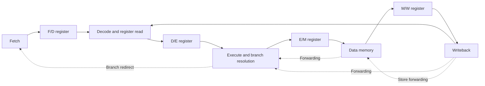

# Five-Stage In-Order RISC-V Core

A SystemVerilog implementation of a 32-bit RISC-V processor with a five-stage
in-order pipeline, data forwarding, hazard stalls, and branch recovery.
Verification combines RTL simulation with an independent sequential RV32I model.

The processor passes **38 instruction benchmarks and 10 full-program benchmarks**.
The current suite checks **17,848 retired instructions**, including register
results, instruction order, and memory stores. Three focused regressions cover
store forwarding, wrong-path ECALL handling, and pipeline completion on return.

## Architecture



- RV32I integer arithmetic, logic, shifts, loads, stores, branches, and jumps.
- Memory-to-execute and writeback-to-execute operand forwarding.
- Writeback-to-memory forwarding for store data.
- Load-use and register-file read/write hazard stalls.
- Branches and jumps resolved in execute, with younger instructions flushed.
- Separate instruction and data memories, each initialized from a program image.
- Byte-addressable, little-endian memory with signed and unsigned load handling.

The RTL top module is `pd5` in [pd5.sv](project/pd5/design/code/pd5.sv).
See the [architecture notes](project/pd5/docs/README.md) for interfaces, pipeline
state, and the simulation memory map.

## Requirements

- Verilator with `--binary` and `--timing` support, a C++ compiler, GNU Make,
  and Python 3. The recorded local validation used Verilator 5.045 devel.
- Optional: GTKWave or another VCD viewer.
- To change the C benchmarks: an RV32I-capable bare-metal GCC toolchain with
  GCC, objcopy, and objdump. The rebuild script recognizes `riscv64-elf-`,
  `riscv64-unknown-elf-`, and `riscv32-unknown-elf-` tool prefixes.

On macOS with Homebrew:

```sh
brew install verilator riscv64-elf-gcc
```

The cross compiler is needed only when rebuilding C sources. Precompiled `.x`
images are included for all benchmarks.

## Build and run

Run the following commands from the **repository root**, where this README and
`Makefile` live. No environment setup script is required.

```sh
make help
make test                         # All 48 benchmarks against the RV32I model
make regressions                  # Three focused pipeline regressions
make check PROGRAM=BubbleSort     # Check one benchmark against the model
make sim PROGRAM=BubbleSort       # RTL simulation; reports main's return value
make wave PROGRAM=BubbleSort      # RTL simulation plus a VCD waveform
make dump PROGRAM=BubbleSort      # RTL simulation plus a pipeline pattern dump
```

For an instruction benchmark or a custom image, specify its path:

```sh
make sim PROGRAM=rv32ui-p-add IMAGE="$PWD/rv32-bmarks/insn-bmarks/rv32ui-p-add.x"
```

The root commands resolve build and memory paths automatically. To invoke the
project from another directory, use `make -C /absolute/path/to/In-order-RISC-V-core`.

## Outputs and verification

| Output | Location |
| --- | --- |
| Full-suite JSON results | `project/pd5/verif/sim/benchmarks/results.json` |
| Regression results | `project/pd5/verif/sim/benchmarks/regressions.json` |
| Single-program results | `project/pd5/verif/sim/benchmarks/single-result.json` |
| Per-instruction logs | `project/pd5/verif/sim/benchmarks/<program>.log` |
| VCD waveform | `project/pd5/verif/sim/verilator/<program>-vcd/<program>.vcd` |
| Pipeline pattern dump | `project/pd5/design/Pattern_Dump_BM/<program>.dump` |

The independent checker compares each retired instruction against its own RV32I
interpreter. Instruction benchmarks must finish with `gp = 1`; full programs
must return from `main` with `a0 = 1`. A simulation exit alone is insufficient
for a benchmark pass.

Pipeline dumps capture the implementation's signals each cycle; they are debug
artifacts, not independent golden references. The inherited cycle-pattern
files include a store-data error and unused-bus comparisons. Their known
mismatches are documented in [BENCHMARKS.md](project/pd5/docs/BENCHMARKS.md).

Generated executables, logs, waveforms, and pattern dumps are ignored by Git.

## Change a benchmark

For example, after editing `rv32-bmarks/full-bmarks/BubbleSort.c`:

```sh
make rebuild PROGRAM=BubbleSort
make check PROGRAM=BubbleSort
make dump PROGRAM=BubbleSort
make wave PROGRAM=BubbleSort
```

Rebuilding regenerates `.s`, `.elf`, `.bin`, `.objdmp`, `.x`, and `.raw` together.
PD5 loads the `.x` image; changes to `.c` take effect after a successful rebuild.
The rebuild places `main` at `0x01000000` and targets `-march=rv32i -mabi=ilp32`.
See [the benchmark guide](rv32-bmarks/README.md) for the file formats.

## Repository layout

```text
project/pd5/
  design/code/        Processor RTL
  design/probes.svh  Verification signal mappings
  docs/              Architecture and validation notes
  verif/data/        Directed programs, inherited patterns, and regressions
  verif/tests/       SystemVerilog/C++ testbenches
  verif/scripts/     Simulator builds and independent RV32I checker
rv32-bmarks/
  full-bmarks/       C programs and compiled artifacts
  insn-bmarks/       RV32I instruction benchmarks
  rebuild.py         C benchmark rebuild utility
common/              Shared simulator Makefile support
.github/workflows/   Automated benchmark and regression checks
```

## Scope

This is a simulation-validated educational processor implementation. The memory
models and program termination hooks support bare-metal testing. There is no
branch predictor, privileged execution, CSR/trap subsystem, or M/A/C extension
support. Memory addresses wrap within the configured RAM rather than raising
access exceptions. No FPGA implementation, timing closure, or formal
verification result is claimed.

## Acknowledgments

The project builds on the scaffolding and benchmark assets from York University's
[EECS 4201 processor project](https://github.com/akaushikyu/EECS-4201-project).
The original RV32I reference card and benchmark sources are retained. Earlier
incremental deliverables have been removed from this working tree so the
repository focuses on the integrated pipelined processor.
